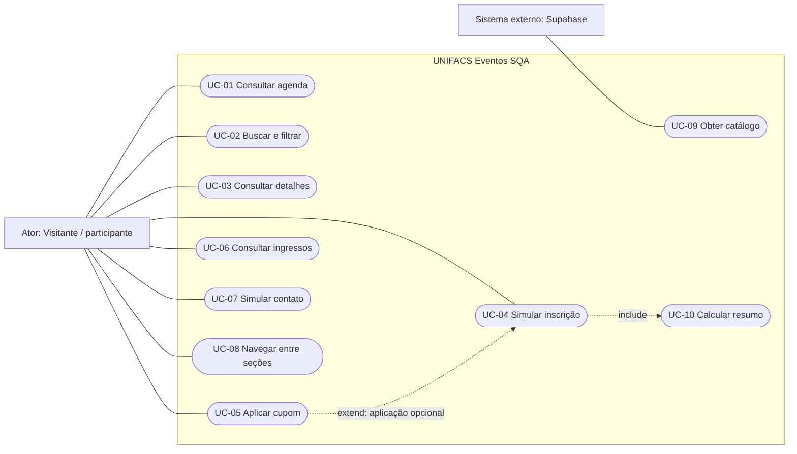

# 4. Casos de uso

[Índice](README.md) · [Anterior: regras](03-regras-de-negocio.md) · [Próximo: arquitetura](05-arquitetura-e-execucao.md)

## 4.1 Atores e fronteira

- **Visitante/participante:** ator principal de todos os casos de uso da interface, sem autenticação.
- **Serviço de catálogo Supabase:** sistema externo de apoio à leitura de eventos, quando configurado.

O aluno avaliador assume o papel de visitante ao testar. Docente e responsável técnico ficam fora da fronteira funcional da interface. Configurar o banco e publicar o build são atividades operacionais, não casos de uso de um painel administrativo inexistente.

## 4.2 Diagrama de casos de uso

Representação conceitual com elipses em Mermaid. Linhas contínuas mostram associação; setas tracejadas rotuladas representam inclusão obrigatória ou extensão opcional. A direção de `include` vai do caso que utiliza para o caso incluído; a de `extend`, da extensão para o caso base.

Consultar detalhes é uma etapa anterior à inscrição, mas abrir detalhes não obriga a se inscrever. Obter catálogo acontece na inicialização e pode usar somente dados locais; a participação do Supabase é condicional. A agenda utiliza o catálogo ativo sem exigir nova consulta remota a cada navegação. Recalcular o resumo é comportamento interno incluído na inscrição.

## 4.3 UC-01 · Consultar agenda

- **Objetivo:** conhecer os eventos disponíveis no catálogo da aplicação.
- **Ator:** visitante.
- **Gatilho:** acessar a página ou escolher Eventos.
- **Precondições:** aplicação carregada com JavaScript disponível.
- **Fluxo principal:**
  1. O sistema utiliza o catálogo ativo, resolvido por UC-09 na inicialização da instância.
  2. O sistema apresenta cartões com identificação, categoria, data, horário, local e preço de referência.
  3. O visitante percorre a agenda e escolhe buscar, filtrar ou abrir detalhes.
- **Alternativas:** a fonte remota não pode ser utilizada; aplica-se o catálogo local de RN-15. Ausência de resultados de filtros é tratada por UC-02.
- **Pós-condição:** agenda disponível, sem criação de inscrição.
- **Rastreabilidade:** RF-02, RF-18; RN-01, RN-03, RN-15.

## 4.4 UC-02 · Buscar e filtrar eventos

- **Objetivo:** restringir a agenda aos eventos de interesse.
- **Ator:** visitante.
- **Gatilho:** selecionar categoria ou preencher busca.
- **Precondições:** agenda disponível.
- **Fluxo principal:**
  1. O visitante seleciona uma categoria e/ou digita um texto.
  2. O sistema aplica os dois critérios sobre o catálogo ativo.
  3. O sistema atualiza cartões e quantidade de resultados.
  4. O visitante ajusta os critérios ou abre um evento.
- **Alternativas:**
  - Nenhum evento atende aos critérios: apresentar estado vazio e ação para ver todos.
  - O visitante limpa a pesquisa e escolhe Todos: remover ambas as restrições.
- **Pós-condição:** resultado corresponde aos critérios em vigor, sem alterar o catálogo.
- **Rastreabilidade:** RF-03 a RF-05; RN-04.

## 4.5 UC-03 · Consultar detalhes do evento

- **Objetivo:** conhecer programação e condições antes de decidir pela inscrição.
- **Ator:** visitante.
- **Gatilho:** acionar a imagem ou o controle de inscrição de um cartão.
- **Precondições:** evento presente no catálogo ativo.
- **Fluxo principal:**
  1. O sistema abre o diálogo associado ao evento selecionado.
  2. O sistema apresenta título, descrição, data, horário, local e programação.
  3. O visitante lê as informações e pode iniciar UC-04.
- **Alternativas:** o visitante fecha o diálogo por um controle de fechamento ou Escape; o foco e a interação retornam à página. Uma mudança de seção deve manter a navegação coerente.
- **Pós-condição:** somente a consulta não cria inscrição.
- **Rastreabilidade:** RF-06, RF-07; RN-03, RN-12.

## 4.6 UC-04 · Simular inscrição

- **Objetivo:** criar um registro demonstrativo para o evento selecionado.
- **Ator:** participante, no mesmo papel de visitante.
- **Gatilho:** preencher e concluir o formulário de inscrição.
- **Precondições:** diálogo de um evento aberto; somente dados sintéticos disponíveis.
- **Fluxo principal:**
  1. O participante informa nome, e-mail e CPF fictícios.
  2. Informa quantidade e seleciona categoria de ingresso.
  3. O sistema atualiza o resumo por UC-10.
  4. Opcionalmente, o participante aplica um cupom por UC-05.
  5. O participante revisa os dados e aciona Finalizar inscrição.
  6. O sistema valida os dados e as regras aplicáveis.
  7. O sistema cria uma inscrição demonstrativa identificável na memória da instância atual.
  8. O registro fica disponível para consulta em Meus Ingressos.
- **Alternativas e exceções esperadas:**
  - Dados inválidos: não criar registro; orientar correção e manter a interface utilizável.
  - Fechamento sem conclusão: encerrar o formulário sem criar inscrição.
  - Repetição involuntária da ação: preservar uma única conclusão para a mesma operação, conforme RN-10.
  - Recarregamento da página: aplicar o ciclo de vida de RN-12; não prometer recuperação.
- **Pós-condição de sucesso:** uma nova inscrição válida está na lista da instância atual.
- **Pós-condição sem sucesso:** nenhuma nova inscrição é criada por tentativa inválida ou cancelada.
- **Rastreabilidade:** RF-08 a RF-13, RF-21; RN-01, RN-02, RN-05 a RN-12.

## 4.7 UC-05 · Aplicar cupom

- **Objetivo:** aplicar o benefício demonstrativo ao resumo da inscrição.
- **Ator:** participante.
- **Gatilho:** acionar Aplicar no campo de cupom.
- **Precondições:** formulário aberto; evento e categoria definidos; quantidade válida para cálculo.
- **Fluxo principal:**
  1. O participante informa o código.
  2. O sistema interpreta o código segundo RN-09.
  3. O sistema informa a aceitação do cupom válido.
  4. O resumo é recalculado por UC-10.
- **Alternativas:** código vazio ou desconhecido não concede desconto e recebe resposta compreensível; uma nova aplicação substitui a anterior. Editar o texto sem aplicar não é uma nova aplicação.
- **Pós-condição:** resumo reflete o cupom efetivamente aplicado, sem criar inscrição.
- **Rastreabilidade:** RF-11, RF-12; RN-08, RN-09.

## 4.8 UC-06 · Consultar ingressos

- **Objetivo:** acompanhar as inscrições da instância atual da aplicação.
- **Ator:** visitante.
- **Gatilho:** escolher Meus Ingressos.
- **Precondições:** aplicação carregada; não exige inscrições anteriores.
- **Fluxo principal:**
  1. O sistema acessa a lista de inscrições em memória.
  2. Apresenta a quantidade de inscrições e os registros, com dados do evento, participante fictício, quantidade, categoria, valor e código demonstrativo.
  3. Informa a natureza temporária dos registros.
- **Alternativas:** lista vazia apresenta orientação e acesso à agenda. Depois de recarregar a página, a nova instância começa sem inscrições.
- **Pós-condição:** consulta não altera registros nem realiza pagamento.
- **Rastreabilidade:** RF-14, RF-15; RN-10 a RN-12.

## 4.9 UC-07 · Simular contato

- **Objetivo:** preencher uma mensagem e visualizar uma prévia local.
- **Ator:** visitante.
- **Gatilho:** acessar Contato e acionar Enviar mensagem.
- **Precondições:** seção Contato aberta; dados exclusivamente sintéticos.
- **Fluxo principal:**
  1. O visitante preenche nome e e-mail fictícios, assunto e mensagem.
  2. O sistema valida os campos obrigatórios.
  3. O sistema apresenta a mensagem em uma prévia isolada.
  4. O usuário pode revisar o conteúdo localmente.
- **Alternativas:** preenchimento inválido não conclui a simulação e recebe orientação. Sair da seção ou reiniciar a aplicação não cria um histórico de contatos.
- **Pós-condição:** nenhuma mensagem foi entregue a uma pessoa ou serviço; a prévia é transitória e isolada.
- **Rastreabilidade:** RF-16, RF-17, RF-21; RN-02, RN-13, RN-14.

## 4.10 UC-08 · Navegar entre seções

- **Objetivo:** acessar as áreas do sistema com coerência de URL e histórico.
- **Ator:** visitante.
- **Gatilho:** link de navegação, botão de retorno, fragmento de URL, Voltar ou Avançar.
- **Precondições:** aplicação carregada.
- **Fluxo principal:**
  1. O visitante escolhe uma seção.
  2. O sistema atualiza o conteúdo e o fragmento correspondente.
  3. Atualiza a indicação da seção atual e encerra estados de navegação incompatíveis.
  4. Preserva as inscrições da instância atual.
- **Alternativas:** em tela pequena, abrir o menu antes de selecionar; fragmento desconhecido ou vazio resolve para Eventos.
- **Pós-condição:** seção, URL e controles refletem o mesmo destino.
- **Rastreabilidade:** RF-01, RF-19, RF-20; RN-12, RN-16.

## 4.11 UC-09 · Obter catálogo

- **Objetivo:** fornecer eventos à interface sem depender obrigatoriamente da fonte remota.
- **Ator de apoio:** serviço Supabase, somente quando configurado.
- **Gatilho:** inicialização da instância da aplicação.
- **Precondições:** catálogo local incorporado ao build.
- **Fluxo principal:**
  1. A aplicação começa com a base local.
  2. Se houver configuração remota válida, consulta o catálogo por HTTPS, em modo somente leitura.
  3. Confere a compatibilidade e a presença de registros na resposta.
  4. Disponibiliza o catálogo remoto válido para a agenda.
- **Alternativas:** configuração ausente ou inadequada, falha de rede, erro de resposta, lista vazia ou contrato incompatível levam à base local. Interrupção da instância cancela a leitura pendente.
- **Pós-condição:** uma fonte de catálogo é utilizada, sem envio de dados de inscrição nem gravação remota.
- **Rastreabilidade:** RF-18; RN-15; RNF-08, RNF-10.

## 4.12 UC-10 · Calcular resumo

- **Objetivo:** apresentar os valores da inscrição de forma consistente.
- **Iniciador:** formulário de inscrição.
- **Gatilho:** abrir o formulário ou modificar uma entrada que afeta os valores.
- **Precondições:** preço base, quantidade válida, categoria e estado do cupom conhecidos.
- **Fluxo principal:**
  1. Calcular o subtotal com o fator da categoria.
  2. Determinar o desconto aplicável.
  3. Calcular o total e apresentar os valores em reais.
- **Alternativas:** quantidade inválida impede a conclusão; cupom não válido não gera desconto. A aplicação deve continuar utilizável para correção.
- **Pós-condição:** resumo corresponde às RN-07 a RN-09, sem cobrança ou criação autônoma de ingresso.
- **Rastreabilidade:** RF-10, RF-11, RF-12; RN-06 a RN-09; RNF-05, RNF-14.

