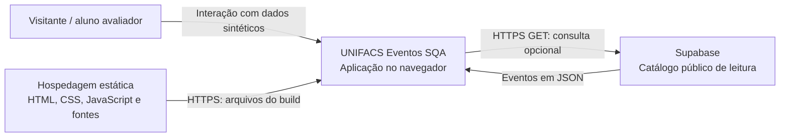
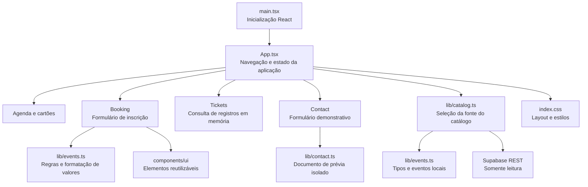
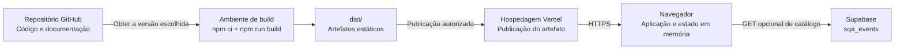

# 5. Arquitetura e execução

[Índice](README.md) · [Anterior: casos de uso](04-casos-de-uso.md) · [Próximo: dados](06-modelo-de-dados.md)

Esta seção descreve a estrutura técnica existente na base consultada. Os critérios de aceitação continuam definidos nos requisitos e nas regras, e precisam ser verificados separadamente.

## 5.1 Visão geral

A aplicação é uma **SPA** (Single-Page Application) React com TypeScript, compilada pelo Vite em arquivos estáticos. O navegador executa a interface e mantém os estados de navegação, formulários e inscrições. Não há backend próprio de inscrições, autenticação ou contato.

O catálogo possui uma fonte local incorporada ao código e uma integração opcional com a API REST do Supabase. Essa integração é real quando configurada, mas seu alcance é somente a leitura de eventos. Dados dos formulários não são gravados no Supabase.

### Diagrama de contexto



Não há ligação dos formulários com um serviço de pagamento, identidade ou envio de mensagens. A hospedagem e a consulta do catálogo ainda envolvem requisições normais de rede; “dados locais” não significa ausência de tráfego para carregar a aplicação.

## 5.2 Tecnologias

| Camada | Tecnologia | Responsabilidade |
| --- | --- | --- |
| Interface | React 19 e TypeScript | Componentes, estado e contratos de tipos. |
| Build e desenvolvimento | Vite 7 | Servidor de desenvolvimento e geração de `dist/`. |
| Estilos | Tailwind CSS 4 e CSS do projeto | Layout, cores, responsividade e estilos dos componentes. |
| Componentes básicos | Componentes locais com Radix/shadcn/ui | Botões, entradas e diálogo. |
| Ícones e tipografia | Lucide, Figtree e Marcellus | Recursos visuais; fontes empacotadas localmente. |
| Testes automatizados | Vitest, Testing Library e jsdom | Testes executados em ambiente simulado de DOM. |
| Catálogo remoto opcional | Supabase REST/PostgreSQL | Leitura da tabela `sqa_events`. |
| Hospedagem | Arquivos estáticos, com configuração Vercel | Entrega do build ao navegador. |

Versões exatas de dependências são fixadas pelo [package-lock.json](../package-lock.json); os intervalos estão no [package.json](../package.json).

## 5.3 Componentes e responsabilidades



As caixas representam responsabilidades, não serviços distribuídos. Os componentes de tela principais estão no mesmo `App.tsx`, e não em arquivos separados. `lib/events.ts` reúne tipos, catálogo local e funções do domínio.

## 5.4 Navegação e estado

- A navegação utiliza `window.location.hash`: `#eventos`, `#ingressos` e `#contato`.
- A aplicação acompanha mudanças do fragmento e mantém o conteúdo da seção correspondente.
- `App` mantém catálogo, página, menu, evento selecionado, lista de ingressos, categoria e texto de busca.
- `Booking` mantém o preenchimento do formulário e o cupom durante a montagem daquele formulário.
- `Contact` mantém a mensagem e a prévia enquanto seu componente está montado.
- Inscrições são objetos em estado React. Não há tabela remota, armazenamento local persistente ou sessão autenticada para esses registros.

Não se deve interpretar fechamento de diálogo, troca de seção e recarregamento da página como eventos equivalentes: eles afetam escopos diferentes de estado. Os efeitos esperados constam em RN-12 e nos diagramas de fluxo.

## 5.5 Contrato da integração de catálogo

| Elemento | Contrato atual |
| --- | --- |
| Configuração | `VITE_SUPABASE_URL` e `VITE_SUPABASE_ANON_KEY`, fornecidas no build. |
| Serviço aceito pelo carregador | Endereço HTTPS com host terminado em `.supabase.co`. |
| Operação | `GET /rest/v1/sqa_events?select=*&order=date.asc`. |
| Autorização do cliente | Chave pública de cliente; não usar segredo administrativo. |
| Retorno | Lista JSON não vazia, compatível com `CampusEvent`. |
| Escrita | Não utilizada pelo frontend. |
| Alternativa local | Configuração ausente/inadequada, erro ou resposta vazia/incompatível utilizam o catálogo incorporado. |
| Cancelamento | `AbortController` acompanha a vida da leitura iniciada pela aplicação. |

O SQL do repositório habilita RLS e concede leitura às funções públicas de cliente, sem conceder gravação. A configuração efetiva do ambiente deve ser verificada pelo responsável técnico. Existência de um script no repositório não comprova, sozinha, o estado de todas as instalações.

O contrato é específico do carregador atual; não promete suporte a domínios personalizados, instâncias auto-hospedadas ou múltiplos provedores. Não são necessários endereços de projeto, chaves ou credenciais nos relatórios dos alunos.

## 5.6 Prévia do contato e fronteira de segurança

A mensagem é apresentada em um `iframe` com documento próprio, sandbox e política de segurança de conteúdo. Não há chamada de envio a servidor. A prévia deve permanecer isolada da página principal, sem permissões de mesma origem e sem acesso de rede. Não remova essas barreiras durante os testes.

O formulário não é um serviço de atendimento, e o nome de uma ação na interface não deve ser interpretado como comprovante de entrega. A avaliação deve considerar simultaneamente a clareza do caráter demonstrativo e os limites de isolamento definidos nos requisitos.

## 5.7 Executar localmente

Pré-requisitos: Node.js 22.12+ ou 24 LTS, npm e uma cópia do repositório. Consulte instruções mais recentes no [README](../README.md).

```bash
npm ci
npm run dev
```

Abra o endereço informado pelo Vite. Não é necessário Docker. O catálogo local permite iniciar sem configurar Supabase.

Para verificações e build:

```bash
npm run typecheck
npm test
npm run build
npm run preview
```

O build é gerado em `dist/`. O preview deve ser executado após o build. Os testes automatizados incluídos são verificações iniciais, não cobertura completa dos requisitos. O projeto não define um script `lint` nesta base.

## 5.8 Configuração remota e publicação

A preparação do catálogo é uma atividade do responsável técnico, em ambiente autorizado. O [SQL do catálogo](../supabase/catalog.sql) e o [.env.example](../.env.example) descrevem os insumos sem exigir a publicação de segredos. A aplicação também pode ser utilizada sem essa configuração.

Variáveis com prefixo `VITE_` são incorporadas ao frontend durante o build e não devem receber segredos. Alterá-las depois de gerar os arquivos exige novo build e publicação para mudar o comportamento do site estático.

### Diagrama de implantação



O fluxo de disponibilização do laboratório utiliza artefato estático por **Vercel Drop**. Um commit no GitHub, por si só, não implica deploy automático nesse fluxo. Não há seta direta de sincronização contínua entre o repositório e a hospedagem no diagrama. Uma integração Git futura exigiria configuração própria.

O arquivo `vercel.json` também descreve comandos de build, diretório de saída, cabeçalhos e reescrita para um projeto Vercel compatível. A aplicação efetiva dessa configuração depende do método de publicação. Não presuma que publicar um arquivo Markdown republica a aplicação, nem que o site em execução já corresponde ao último commit.

## 5.9 Limites operacionais

Não há ambiente administrativo no frontend, SLA de produção, processamento de pagamento, fila de mensagens ou recuperação de ingressos. Alterações de catálogo, permissões, infraestrutura e deploy não fazem parte da tarefa de teste comum do aluno. Não execute SQL nem modifique serviços compartilhados para produzir evidências sem autorização do responsável.

