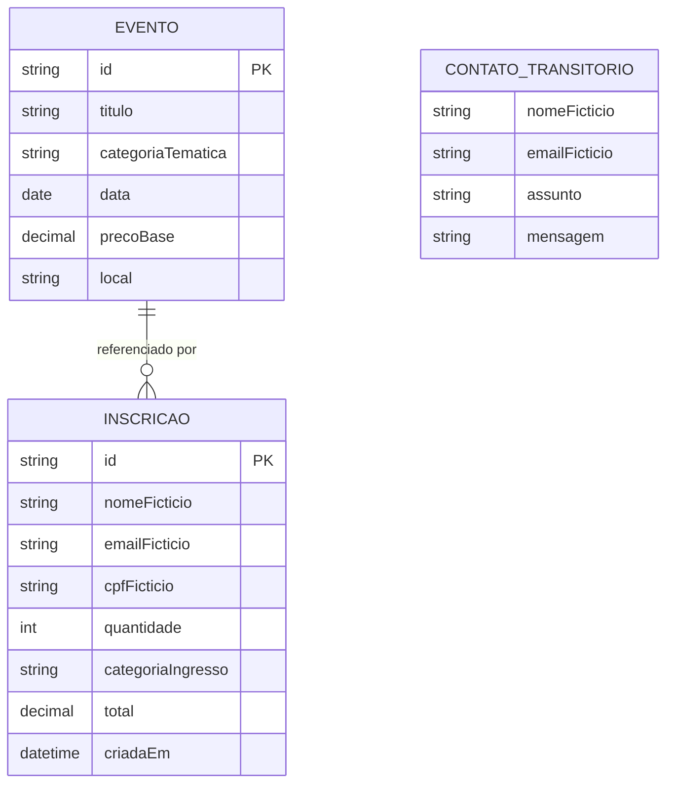
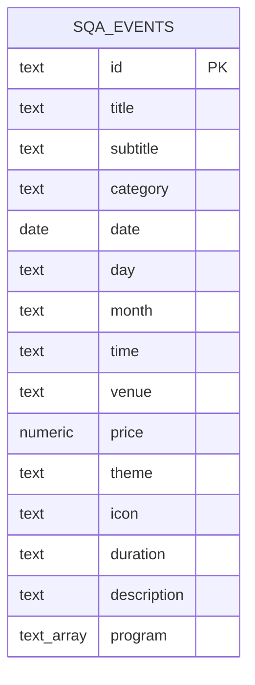

# 6. Modelo e dicionário de dados

[Índice](README.md) · [Anterior: arquitetura](05-arquitetura-e-execucao.md) · [Próximo: fluxos](07-fluxos-e-estados.md)

## 6.1 Modelo conceitual

**Evento** é um item do catálogo. **Inscrição** registra uma simulação para um evento, com uma quantidade de ingressos de uma categoria. **Contato** é um preenchimento transitório com prévia local. Não existe entidade de usuário autenticado.

Este é um **modelo conceitual**, não um esquema SQL de todas as entidades. Um evento pode ter nenhuma ou várias inscrições; cada inscrição se refere a um único evento. A relação é mantida por objeto no frontend. Contato é independente e não possui relacionamento persistido com inscrição. Não existem tabelas de inscrição ou contato no SQL desta edição.

## 6.2 Modelo físico do catálogo remoto

O único objeto de dados de negócio criado pelo script SQL é `public.sqa_events`. A base local usa objetos com o contrato `CampusEvent` equivalente.

Todos os atributos são obrigatórios no esquema SQL. `id` é chave primária; `price` é `numeric(10,2)` com restrição de valor não negativo; `theme` e `icon` possuem conjuntos de valores permitidos. A política de leitura é descrita em [arquitetura](05-arquitetura-e-execucao.md).

## 6.3 Dicionário de Evento / CampusEvent

| Campo | Tipo no frontend | Significado e regra |
| --- | --- | --- |
| `id` | `string` | Identificador estável e único no catálogo. Não é identificador de participante. |
| `title` | `string` | Título do evento. |
| `subtitle` | `string` | Chamada curta usada no cartão. |
| `category` | `string` | Categoria temática. A interface oferece Inovação, Tecnologia e Cultura, além do filtro Todos. |
| `date` | `string` | Data de calendário, no formato `AAAA-MM-DD`; o banco utiliza o tipo `date`. |
| `day` | `string` | Dia usado na apresentação resumida. Deve ser coerente com `date`. |
| `month` | `string` | Abreviação do mês para apresentação; deve corresponder a `date`. |
| `time` | `string` | Intervalo de horário para leitura humana, não um campo de cálculo de duração. |
| `venue` | `string` | Local/campus e cidade demonstrativos. |
| `price` | `number` | Preço base de um ingresso Inteira, em reais, não negativo. |
| `theme` | união de strings | Tema visual: `blue`, `red` ou `sand`. |
| `icon` | união de strings | Identidade gráfica: `ideas`, `code` ou `art`. |
| `duration` | `string` | Descrição de duração existente no contrato; não implica exibição em todas as telas. |
| `description` | `string` | Texto de apresentação detalhada. |
| `program` | `string[]` | Itens de programação em ordem de apresentação. |

Datas são datas demonstrativas de calendário, sem conversão de fuso para decidir inscrições. O escopo não define bloqueio automático de eventos passados. `day`, `month` e `date` são representações relacionadas e sua coerência faz parte da avaliação de qualidade.

## 6.4 Dicionário de Inscrição / Ticket

| Campo | Tipo no frontend | Significado |
| --- | --- | --- |
| `id` | `string` | UUID gerado para o registro. A interface usa uma forma abreviada como código demonstrativo. |
| `event` | `CampusEvent` | Referência ao objeto do evento selecionado no momento da inscrição. Não é uma chave estrangeira em tabela de inscrições. |
| `name` | `string` | Nome fictício do participante. |
| `email` | `string` | E-mail sintético; não dispara comunicação. |
| `cpf` | `string` | Documento sintético para o exercício; não comprova identidade. |
| `quantity` | `number` | Quantidade sujeita à regra de inteiro positivo. |
| `category` | `TicketCategory` | Inteira, Estudante ou Comunidade. |
| `total` | `number` | Valor total demonstrativo da inscrição no momento de criação. |
| `createdAt` | `string` | Data/hora de criação em representação ISO. Não estabelece prazo comercial. |

O contrato de `Ticket` não contém status de pagamento, comprovante, código de cupom ou conta de usuário. O registro não é um título comercial e não precisa de integração financeira.

## 6.5 Contato e valores derivados

O formulário apresenta nome, e-mail, assunto e mensagem. As opções de assunto são Dúvidas sobre eventos, Minha inscrição, Sugestões e ideias e Outros assuntos. O código mantém a mensagem digitada e o conteúdo submetido para construir a prévia; não cria objeto persistente de contato com número de protocolo.

Subtotal, desconto e total são valores derivados do evento e do formulário. O estado diferencia o texto digitado no campo de cupom do cupom aplicado. Somente os dados definidos no contrato de inscrição são armazenados no registro em memória.

## 6.6 Ciclo de vida e classificação dos dados

| Dado | Origem | Local e duração | Compartilhamento pelo fluxo de negócio |
| --- | --- | --- | --- |
| Catálogo local | Arquivo do projeto | Incorporado ao build e carregado na aplicação. | Arquivos estáticos entregues ao navegador. |
| Catálogo remoto | Supabase configurado | Persistido em `sqa_events`; cópia lida no estado do frontend. | Leitura pública de eventos. |
| Inscrição demonstrativa | Formulário | Estado React da instância atual; não persistente. | Nenhum backend de inscrições. |
| Preenchimento da inscrição | Formulário aberto | Estado do componente de formulário. | Não enviado a serviço de negócio. |
| Mensagem e prévia | Formulário de contato | Estado transitório do componente e documento isolado. | Sem envio de mensagem a terceiros. |
| Resultado de teste | Trabalho do aluno | Local definido na atividade ou issue autorizada. | Somente evidências sintéticas, sem credenciais. |

Nome, e-mail e CPF seriam dados pessoais se pertencessem a alguém real. A exigência de massa sintética permanece mesmo sem persistência: telas, gravações, logs e capturas podem divulgar conteúdo. Não adicione valores reais à documentação nem aos relatos.

## 6.7 Glossário

- **Catálogo:** conjunto de eventos disponível para consulta.
- **Categoria temática:** agrupamento de eventos por assunto.
- **Categoria de ingresso:** modalidade que determina o fator de preço.
- **Inscrição:** registro demonstrativo de uma conclusão; pode conter vários ingressos.
- **Sessão de uso:** vida de uma instância da aplicação carregada na aba, sem autenticação.
- **SPA:** aplicação que atualiza as seções no navegador sem carregar uma página HTML diferente para cada seção.
- **Fallback:** uso da alternativa local quando a fonte remota não é utilizada.
- **RLS:** política de acesso a linhas no banco de dados.
- **Sandbox:** restrição de capacidades do documento de prévia.
- **CSP:** política de segurança de conteúdo, que limita recursos e conexões permitidos.

