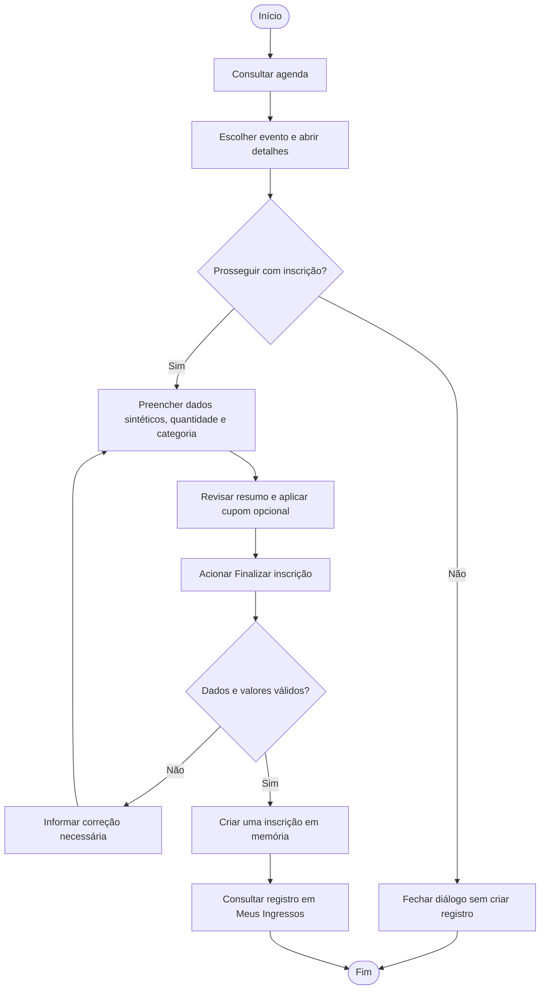
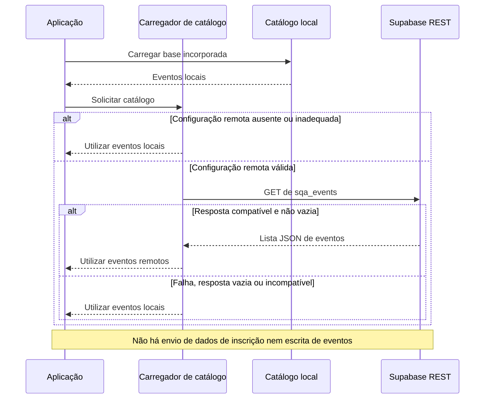
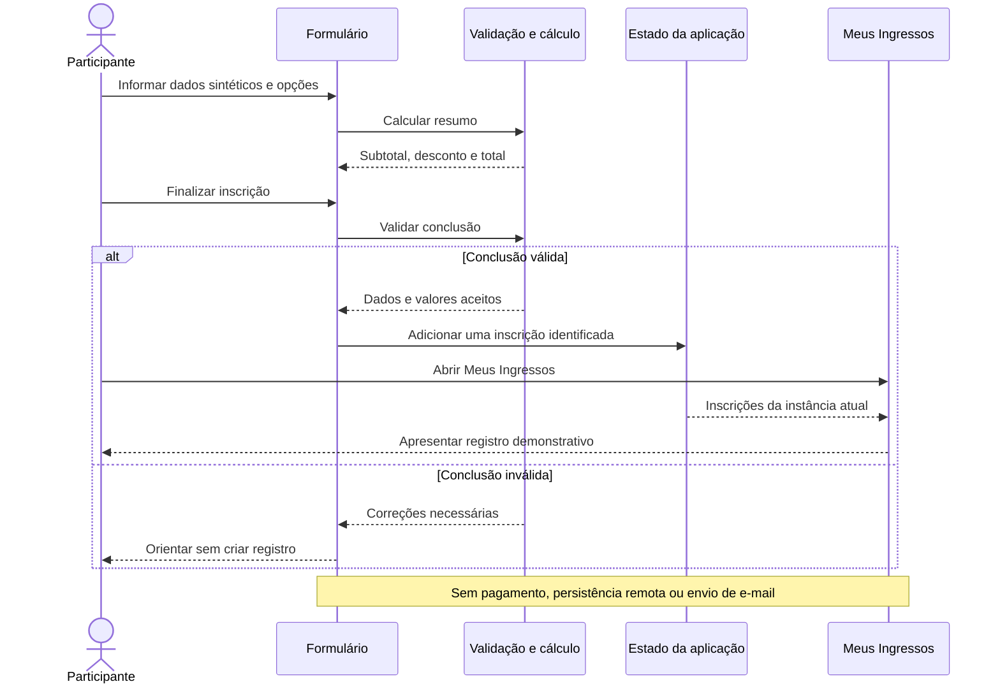
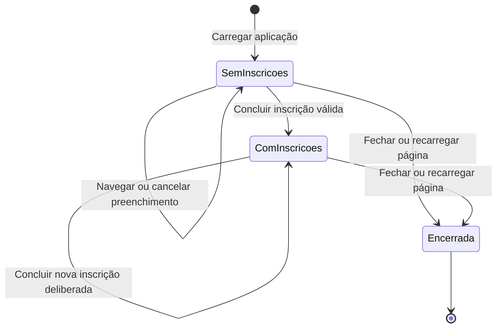
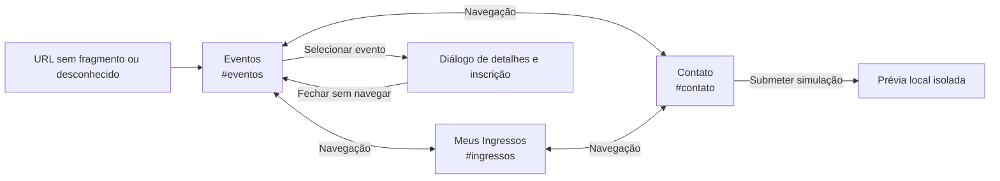

# 7. Diagramas de fluxos e estados

[Índice](README.md) · [Anterior: dados](06-modelo-de-dados.md) · [Próximo: testes](08-testes-e-rastreabilidade.md)

Os diagramas 7.1, 7.3, 7.4 e 7.5 descrevem comportamento esperado do escopo atual. O diagrama 7.2 representa o fluxo técnico de leitura do catálogo na base consultada. Nenhum diagrama comprova, por si só, aprovação de testes.

## 7.1 Atividade: inscrição demonstrativa

A criação acontece após a validação. A consulta em Meus Ingressos é uma ação disponível após a conclusão, não uma promessa de redirecionamento automático. Fechar sem concluir não cria registro. Este fluxo relaciona UC-03, UC-04, UC-05, UC-06 e UC-10.

## 7.2 Sequência: resolução do catálogo

O catálogo local já permite apresentar a agenda durante a leitura. A substituição ocorre somente quando o resultado remoto é utilizável. A leitura pendente pode ser cancelada com o encerramento da instância, sem atualizar uma instância já desmontada.

## 7.3 Sequência esperada: criação e consulta de inscrição

“Validação e cálculo” representa uma responsabilidade lógica, não um servidor ou módulo adicional já existente. A aplicação continua sendo executada no navegador.

## 7.4 Estados: vida das inscrições

Recarregar cria uma nova instância, que inicia em SemInscricoes. O encerramento não é um cancelamento comercial nem conserva dados para recuperação. O diagrama descreve o estado da coleção da aplicação, não os estados de um pagamento.

## 7.5 Mapa de navegação e interação

O diálogo não possui rota própria no escopo atual. A prévia faz parte da seção Contato. Voltar e Avançar devem acompanhar o histórico de fragmentos, e a navegação não deve conservar sobreposições incompatíveis com a seção atual. Esses comportamentos devem ser avaliados em conjunto com o foco de teclado e o menu móvel.

